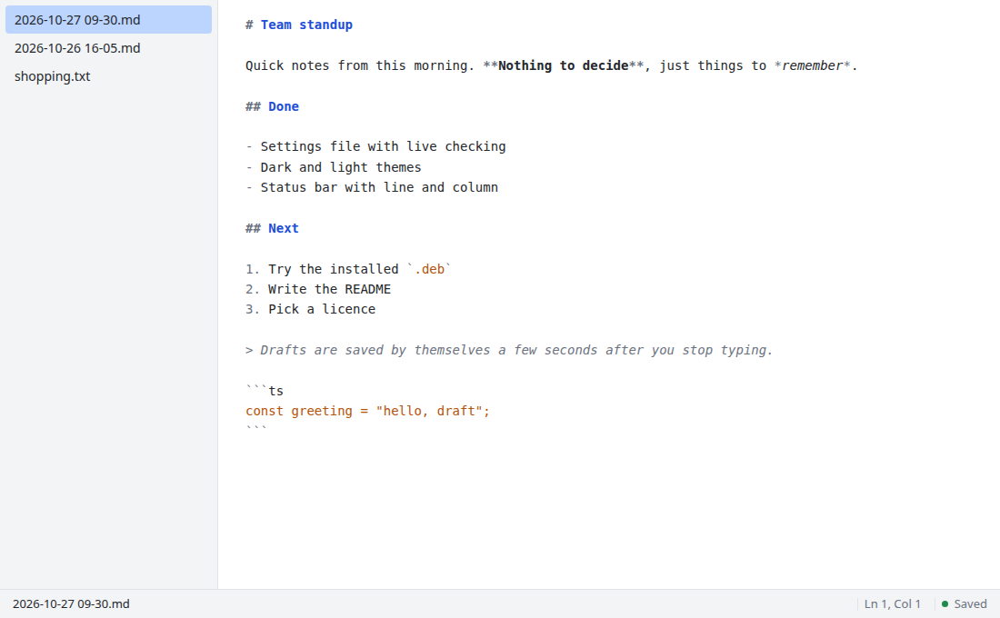

<div align="center">


# Draftwick

**A small, fast desktop editor for quick drafts.**
Meeting notes, pasted chat or web text, scratch Markdown: open it, type, and it is saved.

</div>

<p align="center">
  <picture>
    <source media="(prefers-color-scheme: dark)" srcset="docs/screenshot-dark.png">
    
  </picture>
</p>

Draftwick is built for one job: keeping a pile of short Markdown and text drafts, without the weight of a full editor or a notes app. It edits `.md` and `.txt` files in a folder you choose, starts quickly, and never asks you to name a file before you start typing.

Built with [Tauri 2](https://tauri.app/) (Rust), vanilla TypeScript and [CodeMirror 6](https://codemirror.net/).

> **Status:** early (version 0.1.0). Developed and tested on Ubuntu Linux. Windows and macOS should build, but have not been tried.

## Features

- **Type first, name later.** A new draft is a file named by date and time (`2026-10-27 14-05.md`) the moment you type. Rename it whenever you like.
- **Autosave.** Saved a few seconds after you stop typing (5 seconds by default), and when you switch drafts or close the window.
- **Draft list and quick switcher.** A sidebar of your drafts, newest first, and `Ctrl+P` to jump to one by typing part of its name.
- **Markdown highlighting**, a status bar (draft name, line and column, characters selected, saved or unsaved), find and replace, multiple cursors, and list continuation on Enter.
- **Copy as HTML.** Copies your selection, or the whole draft, as HTML with the Markdown as the plain-text version, so it pastes cleanly into an email or document. HTML written inside a draft is shown as text, never run.
- **Move to trash, rename and Save as** from the draft list (right-click) or the File menu. Deleting uses the system trash, so it can be undone.
- **Settings in a plain file** with live checking: mistakes are underlined as you type. Theme (system, dark or light), font, font size, wrap width, line numbers and tab behaviour. Changes apply when you save, or when you switch back to the window.
- **Safe by design.** Your line endings (LF or CRLF) are kept exactly. A draft is never silently recreated after you delete it, and an emptied draft is never autosaved over a file that has text. Files opened from outside your draft folder are only saved when you press `Ctrl+S`.
- **Nothing happens unless you ask.** No dialog opens at start-up, and no folder or file is created until you choose to.

## Install

Draftwick is packaged as a `.deb` and an AppImage. Download one from the [Releases page](https://github.com/surajitbasak109/draftwick/releases), or [build the packages yourself](#build-from-source).

### Debian and Ubuntu (`.deb`)

```bash
sudo apt install ./Draftwick_0.1.0_amd64.deb
```

Draftwick then appears in your application launcher. To remove it: `sudo apt remove draftwick`.

### AppImage (any recent Linux)

```bash
chmod +x Draftwick_0.1.0_amd64.AppImage
./Draftwick_0.1.0_amd64.AppImage
```

If it complains about FUSE, install your distribution's `libfuse2` package.

## First run

1. Start Draftwick. A welcome screen asks where to keep your drafts.
2. Choose **Choose draft directory…**, or **Use ~/Drafts instead** to create and use a `Drafts` folder in your home directory.
3. Start typing. Your first keystroke creates the file.

You can change the folder later with **File > Open/Set draft directory** (`Ctrl+,`).

## Keyboard shortcuts

| Keys | Action |
| --- | --- |
| `Ctrl+N` | New draft |
| `Ctrl+O` | Open a file |
| `Ctrl+S` | Save now |
| `Ctrl+Shift+S` | Save as… |
| `Ctrl+W` | Close the draft (shows a blank one) |
| `Ctrl+Q` | Quit |
| `Ctrl+P` | Go to a draft |
| `Ctrl+Shift+R` | Rename the draft |
| `Ctrl+B` | Show or hide the sidebar |
| `Ctrl+,` | Open or set the draft directory |
| `F11` | Enter or leave full screen |
| `Ctrl+F` / `Ctrl+H` | Find / Replace |
| `Ctrl+D` | Select the next occurrence |
| `Ctrl+Z` / `Ctrl+Shift+Z` | Undo / Redo |
| `Tab` / `Shift+Tab` | Indent / remove one indent |

On macOS, read `Ctrl` as `Cmd`. The full list is under **Help > Keyboard shortcuts**.

## Settings

**Settings > Show settings** lists every setting with its current value, what it does and its default. To change one, choose **Settings > Open settings file**. Draftwick creates `settings.json` from a commented template and opens it in its own editor. Remove the `//` in front of a setting to change it; anything you leave out uses its default.

| Setting | Default | Allowed |
| --- | --- | --- |
| `autosave_delay_ms` | `5000` | 500 to 30000 |
| `theme` | `"system"` | `"system"`, `"dark"`, `"light"` |
| `font_size` | `14` | 8 to 48 |
| `font_family` | system monospace | one installed font name |
| `wrap_column` | `0` (the window edge) | 0, or 20 to 300 |
| `show_line_numbers` | `false` | `true`, `false` |
| `tab_size` | `4` | 2, 4, 8 |
| `translate_tabs_to_spaces` | `true` | `true`, `false` |

Saving the file applies it at once. A mistake is underlined with a message, and your previous settings stay in use until it is fixed. The template, with a description of every setting, is [`settings.example.jsonc`](settings.example.jsonc).

Draftwick's files live in `~/.config/draftwick/` on Linux (`config.json` for its own state and `settings.json` for yours), or the equivalent config folder on other systems.

## Build from source

### Prerequisites

- [Rust](https://rustup.rs/) (stable)
- [Node.js](https://nodejs.org/) (a current version; 22 or newer is recommended) and [pnpm](https://pnpm.io/)
- On Debian and Ubuntu, the system libraries Tauri needs:

  ```bash
  sudo apt install build-essential curl wget file libwebkit2gtk-4.1-dev \
    libxdo-dev libssl-dev libayatana-appindicator3-dev librsvg2-dev
  ```

  Other systems: see the [Tauri prerequisites](https://tauri.app/start/prerequisites/).

### Run and build

```bash
git clone https://github.com/surajitbasak109/draftwick.git
cd draftwick
pnpm install

pnpm tauri dev      # run the app with live reload
pnpm tauri build    # build the .deb and AppImage
```

The packages are written to `src-tauri/target/release/bundle/` (`deb/` and `appimage/`). The first build takes several minutes while the Rust dependencies compile.

To try it without touching your real settings, point it at a throwaway config folder:

```bash
XDG_CONFIG_HOME=/tmp/draftwick-xdg pnpm tauri dev
```

## Development

| Command | What it does |
| --- | --- |
| `pnpm typecheck` | TypeScript type check |
| `pnpm build` | Type check and build the frontend |
| `pnpm test` | Frontend tests (Node's built-in runner) |
| `cd src-tauri && cargo test` | Rust tests |
| `pnpm dev:standin` | Serve the frontend in an ordinary browser on port 1421, against a fake in-memory backend |

How it is put together:

- **`src-tauri/src`** is the Rust side: draft files (`notes.rs`), the app's state (`config.rs`), the settings file and its checker (`settings.rs`), and the menu and the table of actions behind it (`menu.rs`).
- **`src`** is the TypeScript frontend, bundled with Vite. `main.ts` holds the open draft, the actions and the autosave policy; `editor.ts` wraps CodeMirror.
- **`settings.example.jsonc`** is the commented template that Settings > Open settings file writes.
- **`dev/`** and `vite.standin.config.ts` are the browser stand-in. It does not check `settings.json` and cannot show the native menu, dialogs or window.

The project uses **pnpm only**; there is no `package-lock.json`.

## Acknowledgements

[Tauri](https://tauri.app/), [CodeMirror](https://codemirror.net/), [marked](https://marked.js.org/) and the [trash](https://crates.io/crates/trash) crate.

## License

Released under the [MIT License](LICENSE). The app icon is part of the project and is covered by the same licence.
